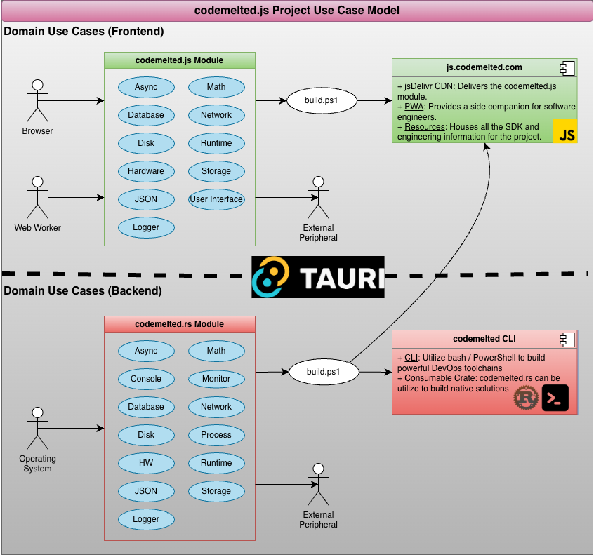
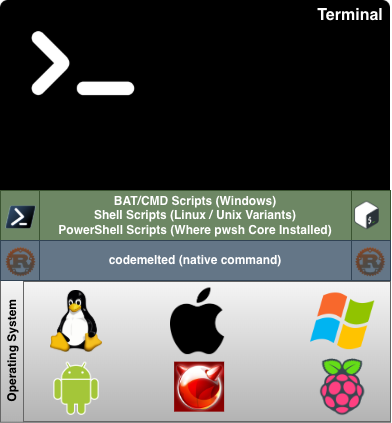

<cm-page-header></cm-page-header>

"Write once, run anywhere (WORA)" was the famous slogan made by Sun Microsystems in 1995. At the time, this technology allowed for easy full stack engineering allowing you to target dedicated workstations and on premise servers. So long as a Java Runtime Environment existed, you could run your code. Java was unable to keep to their slogan as web browsers became more advanced, mobile devices became ubiquitous, and companies no longer required dedicated servers.

The *codemelted.js Project* aims to give software engineers the ability to deliver on the full stack engineering premise. Accomplished via a pair of modules that will facilitate this endeavor.

**Table of Contents**

- [Consumable Modules](#consumable-modules)
- [Native CLI](#native-cli)
- [Building Apps](#building-apps)
- [PWA Companion](#pwa-companion)
- [Support](#support)

# Consumable Modules

Fifteen domain use cases were identified covering the most common areas a software engineer needs a solution. Two modules are being developed to implement these use cases between the frontend and backend tech stacks. With these two modules, software engineers will be able to craft elegant software solutions to any problem they may face utilizing whatever tools that may be at their disposal.

  
    

| Module          | Description                                                                                                                                                                                                                                                                                           |
|-----------------|-------------------------------------------------------------------------------------------------------------------------------------------------------------------------------------------------------------------------------------------------------------------------------------------------------|
| `codemelted.js` | An ES6 module that will deliver the frontend tech stack by allowing quick development of Single Page App (SPA) / Progressive Web App (PWA) web stack solutions. Can also be utilized with the TAURI framework in conjunction with the `codemelted.rs` module to create Desktop / Mobile applications. |
| `codemelted.rs` | Provides the backend tech stack as a native memory safe compiled solution. It will provide a consumable crate to build these solutions, a native command line interface to script solutions, and serve as a dynamic library for inclusion in other higher level applications.                         |

# Native CLI

  
    

| Provides              | What?                                                                                                                  |
|-----------------------|------------------------------------------------------------------------------------------------------------------------|
| Native Command        | The `codemelted` command provides a native CLI available on any BSD / Mac / Linux / Windows operating system.          |
| Scriptable Automation | Facilitates DevOps bash / PowerShell scripting by providing actions that work the same regardless of operating system. |
| Developer Support     | Provides commands specific to developer actions when building application solutions with this project.                 |

# Building Apps

| Target                | Description                                                                                                                        |
|-----------------------|------------------------------------------------------------------------------------------------------------------------------------|
| CLI / CLOUD / SERVICE | Use the `codemelted.rs` module crate to compile Rust services specific to your backend tech stack needs.                           |
| PWA / WEB             | Use the `codemelted.js` ES6 module front end tech stack to build SPA / PWA independent of your chosen backend tech stack.          |
| DESKTOP / MOBILE      | Use both modules in conjunction with the TAURI Rust framework to make performant memory safe Desktop / Mobile native applications. |

# PWA Companion

The `js.codemelted.com` domain is more than just a website. It serves a Software Engineer's companion for building full stack tech solutions. It is a [TypeDoc](https://typedoc.org/) built site with added useful information, services, and utilizes the very modules this project is building.

| Service                               | Description                                                                                                                                                                     |
|---------------------------------------|---------------------------------------------------------------------------------------------------------------------------------------------------------------------------------|
| Domain Use Cases                      | The software engineering applied to building the `codemelted.js` and `codemelted.rs` modules.                                                                                   |
| Software Engineering                  | A knowledge base for applying the discipline to build full stack solution especially in the era of Artificial Intelligence (AI).                                                |
| `codemelted` CLI                      | The `codemelted` native CLI. Contains all the information for installing and utilizing this service.                                                                            |
| `codemelted.js` Validation            | The mocha / chai test page for validating the module. Allows for quick testing across different browser runtimes.                                                               |
| Module SDKs                           | Access to the core of the `codemelted.js` and `codemelted.rs` modules. Provides all the information necessary for install and utilizing these modules within your next project. |
| GitHub Control Integration            | Provides controls to directly access the GitHub repo for this project, fork it, download it, you get it.                                                                        |
| AI Agent (Future)                     | A Gemini AI Notebook to utilize to build solutions for the project modules or access general information based on this sites' information.                                      |
| Code Editor (Future)                  | An online editor for quickly writing snippets of code and UML models based on the project modules and starter templates.                                                        |
| Chat (Future)                         | Bringing back online text chat rooms in the style of AOL / MSN with audio and video chat so like-minded software engineers can collaborate.                                     |
| External Services (Future)            | Access to external services that make the PWA a one-stop solution for a software engineer regardless of how they access this PWA.                                               |
| Page Controls (Future)                | The full ability to print, share (utilizing OpenGraph), and read the page aloud via Text To Speech (TTS)                                                                        |
| codemelted.com Domain Access (Future) | Quick access to the other subdomain projects under the `codemelted.com` domain.                                                                                                 |

# Support

Support for this project is appreciated. We are just getting started so follow the links below to track / support this project.

| Where                                                                                                                                                             | Description                                                                                                                                                                                                   |
|-------------------------------------------------------------------------------------------------------------------------------------------------------------------|---------------------------------------------------------------------------------------------------------------------------------------------------------------------------------------------------------------|
| <a href="https://www.buymeacoffee.com/codemelteddev">Buy Me A Coffee</a> | Direct support for the CodeMeltedDEV content and services offered via the **codemelted.js Project**.                                                                                                          |
| <a href="https://github.com/sponsors/CodeMeltedDEV"> GitHub Sponsorship</a>       | Direct support for the **codemelted.js Project** either through a one time donation or a monthly subscription.                                                                                                |
| <a href="https://dev.codemelted.com"> CodeMeltedDEV Blog</a>                | My website where I will blog about this project along with other interest and utilize this project to build out web features. It is where you can find my socials to follow for updates all things happening. |
