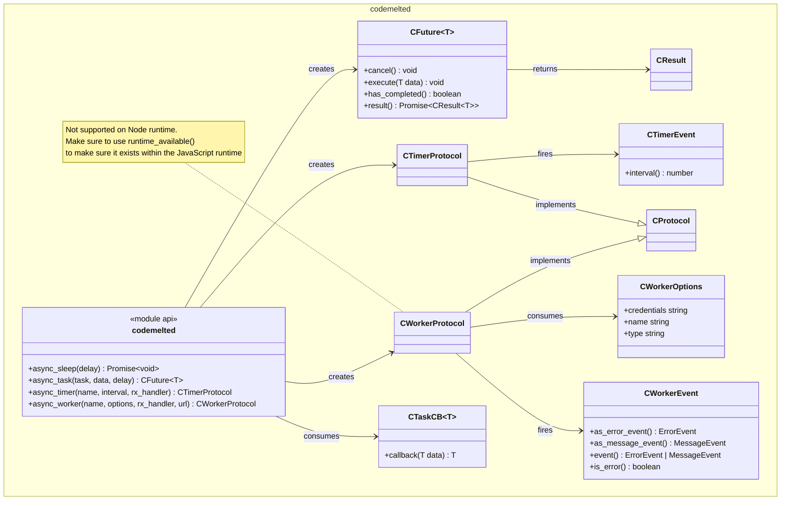

<cm-page-header title="Async Use Case"></cm-page-header>

Complex applications require the ability to asynchronously time slice up work as to not block the main synchronous processing thread.

**Table of Contents**

- [FUNCTIONAL ANALYSIS](#functional-analysis)
  - [UC-01-A: Sleep](#uc-01-a-sleep)
  - [UC-01-B: Task](#uc-01-b-task)
  - [UC-01-C: Timer](#uc-01-c-timer)
  - [UC-01-D: Worker](#uc-01-d-worker)
- [NOTES](#notes)
  - [JavaScript Module](#javascript-module)
  - [Rust Module](#rust-module)
  - [References](#references)

# FUNCTIONAL ANALYSIS

```mermaid
usecase-beta
  direction LR
  actor tech_stack("Tech Stack")
  systemBoundary "UC-01: Async"
    async_sleep("Sleep")
    async_task("Task")
    async_timer("Timer")
    async_worker("Worker")
  end
  tech_stack --> async_sleep
  tech_stack --> async_task
  tech_stack --> async_timer
  tech_stack --> async_worker
```

## UC-01-A: Sleep

1. WHEN invoking a Sleep, THE module SHALL delay for a specified amount of milliseconds.
2. IF the delay is not a number, THEN the module SHALL raise an API violation error.

## UC-01-B: Task

<mark> TO BE DETERMINES </mark>

## UC-01-C: Timer

<mark> TO BE DETERMINES </mark>

## UC-01-D: Worker

<mark> TO BE DETERMINES </mark>

# NOTES

## JavaScript Module

> [!NOTE] `codemelted.js` Front End Module
>
>  1. Sleep, Task, and Timers are asynchronous processing on the Browser runtime main thread. Meaning it carves up the time and is not running in the background. Worker is a dedicated background thread.
>  2. Worker will not work in Node runtime.
>  3. API Violations will result in a thrown `CModuleError`

**Class Architecture**



## Rust Module

<mark> TO BE DETERMINES </mark>

## References

| Reference                                                                                           | Description                                                                |
|-----------------------------------------------------------------------------------------------------|----------------------------------------------------------------------------|
| [C++ Future](https://en.cppreference.com/cpp/thread/future)                                         | To get a general reference design for designing the `CFuture` object.      |
| [Promise](https://developer.mozilla.org/en-US/docs/Web/JavaScript/Reference/Global_Objects/Promise) | A way of dividing up the webpage main thread with different work elements. |
| [Worker](https://developer.mozilla.org/en-US/docs/Web/API/Worker)                                   | Providing a way to spawn background thread processing for a webpage.       |
